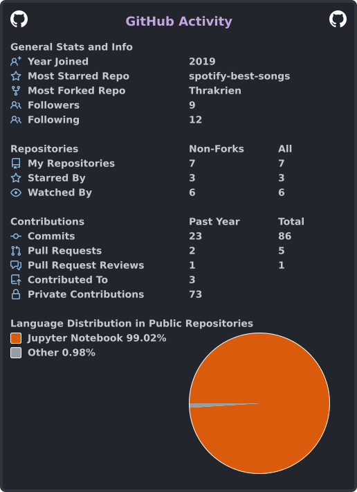

  

  
  
  

  <a href="#-about-me">About me</a> •
  <a href="#-tech-stack">Tech stack</a> •
  <a href="#-projects">Projects</a> •
  <a href="#-off-the-clock">Off the clock</a> •
  <a href="#-github-activity">GitHub activity</a>

---

## 👋 About me

I'm a **Data Scientist** who likes taking models all the way from the notebook to production. These days I'm going deeper into **MLOps**, **Machine Learning architecture** and **Cloud Computing**: pipelines, deployment, monitoring and everything that keeps a model working after it leaves Jupyter.

- 🔭 Working with data science and Machine Learning
- 📄 First author of [IntegraCAR-LULC-10K](https://integracar.github.io/IntegraCAR-LULC-10K/), a paper at SIBGRAPI 2026
- 📚 Learning MLOps, ML architecture and Cloud
- 🐧 Distro-hopper in my spare time (with a [script](https://github.com/Thrakrien/pre-configs-linuxzada) for every fresh start)
- 💬 Happy to talk about data, Linux, books or music on [LinkedIn](https://www.linkedin.com/in/calebe-ferreira-albertino/)

---

## 🧰 Tech stack

<table>
  <tr>
    <td><b>Languages</b></td>
    <td>
      
      
      
    </td>
  </tr>
  <tr>
    <td><b>Machine Learning</b></td>
    <td>
      
      
      
      
    </td>
  </tr>
  <tr>
    <td><b>APIs and data</b></td>
    <td>
      
      
      
      
    </td>
  </tr>
  <tr>
    <td><b>MLOps and Cloud</b></td>
    <td>
      
      
      
      
      
    </td>
  </tr>
</table>

---

## 🚀 Projects

### 📄 Featured publication

<table>
  <tr>
    <td>
      <h3><a href="https://integracar.github.io/IntegraCAR-LULC-10K/">🛰️ IntegraCAR-LULC-10K</a> · SIBGRAPI 2026</h3>
      <b>IntegraCAR-LULC-10K: A High-Resolution Optical Satellite Dataset for LULC Segmentation in the Brazilian Rural Environmental Registry</b>
       
      <i>Calebe Ferreira (first author)</i> et al., Proceedings of the 39th SIBGRAPI Conference on Graphics, Patterns and Images
        
      A dataset of high-resolution optical satellite imagery (0.5 m/pixel) from Espírito Santo, Brazil, for land use and land cover (LULC) semantic segmentation in five classes, supporting the Brazilian Rural Environmental Registry (CAR).
        
      🌐 <a href="https://integracar.github.io/IntegraCAR-LULC-10K/">Project page</a> ·
      💻 <a href="https://github.com/integraCAR/IntegraCAR-LULC-10K-code">Code</a> ·
      🤗 <a href="https://huggingface.co/datasets/laicsiifes/IntegraCAR-LULC-10K">IntegraCAR-LULC-10K dataset</a> ·
      🤗 <a href="https://huggingface.co/datasets/laicsiifes/IntegraCAR-LULC-500">IntegraCAR-LULC-500 benchmark</a>
        
      <code>Remote Sensing</code> <code>Semantic Segmentation</code> <code>PyTorch</code> <code>U-Net</code>
    </td>
  </tr>
</table>

### 🛠️ Side projects

<table>
  <tr>
    <td width="33%" valign="top">
      <h3><a href="https://github.com/Thrakrien/spotify-best-songs">🎧 Spotify Best Songs</a></h3>
      Predicts the popularity of Spotify songs with Machine Learning, with a <a href="https://thrakrien-spotify-popularity.streamlit.app/">Streamlit app</a> you can try.
        
      <code>Python</code> <code>scikit-learn</code> <code>Streamlit</code>
    </td>
    <td width="33%" valign="top">
      <h3><a href="https://github.com/Thrakrien/mastering-project">🃏 Mastering Project</a></h3>
      An end-to-end ETL (extract, transform, load) built on Pokémon TCG card data, covering Data Engineering, Software Engineering and DevOps.
        
      <code>ETL</code> <code>Data Engineering</code> <code>DevOps</code>
    </td>
    <td width="33%" valign="top">
      <h3><a href="https://github.com/Thrakrien/pre-configs-linuxzada">🐧 pre-configs-linuxzada</a></h3>
      A post-install script for Debian/Ubuntu distros that ships the <b>Anti-Blind Theme</b>, a VSCode theme made for people with astigmatism.
        
      <code>Shell Script</code> <code>Linux</code> <code>VSCode</code>
    </td>
  </tr>
</table>

---

## 🎲 Off the clock

<table>
  <tr>
    <td width="50%" valign="top">
      <h3>📚 Classic literature</h3>
      There's always a classic on my nightstand. A good book is one that keeps talking to you centuries after it was written.
    </td>
    <td width="50%" valign="top">
      <h3>🎮 League of Legends and Pokémon</h3>
      From the Rift to the routes of Kanto. Pokémon has even turned into a <a href="https://github.com/Thrakrien/mastering-project">data project</a> around here.
    </td>
  </tr>
  <tr>
    <td width="50%" valign="top">
      <h3>🎸 Guitar</h3>
      Playing is how I switch off from data (almost: counting bars is math too).
    </td>
    <td width="50%" valign="top">
      <h3>🎧 Math rock</h3>
      Odd time signatures, unexpected turns and tapping. Music that feels like a puzzle and makes a great coding soundtrack.
    </td>
  </tr>
</table>

---

## 📊 GitHub activity

---

<i>"To the victor, the potatoes!"</i> · Machado de Assis, <i>Quincas Borba</i>

Colors from the <a href="https://github.com/Thrakrien/pre-configs-linuxzada/tree/main/vscode-theme">Anti-Blind Theme</a> · README inspired by examples from <a href="https://github.com/matiassingers/awesome-readme">awesome-readme</a>

